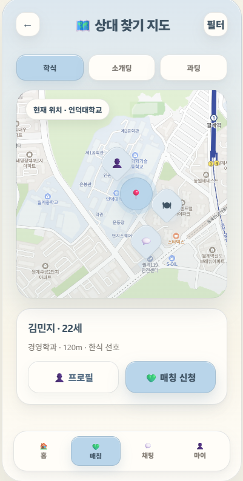
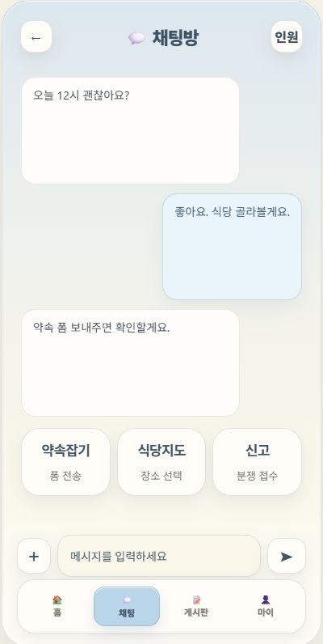
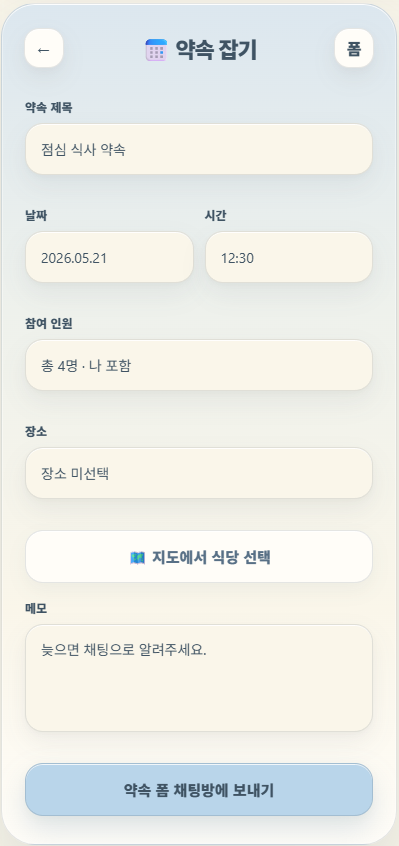
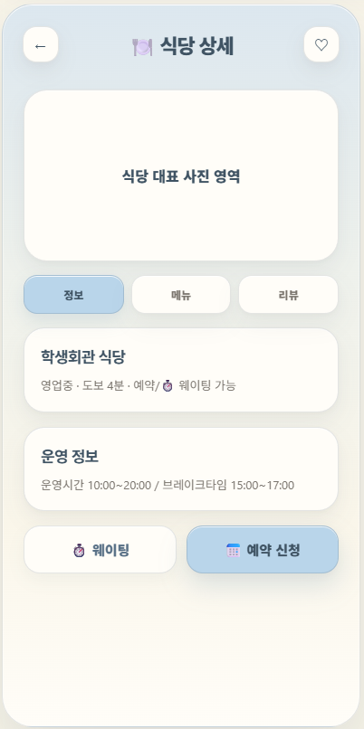
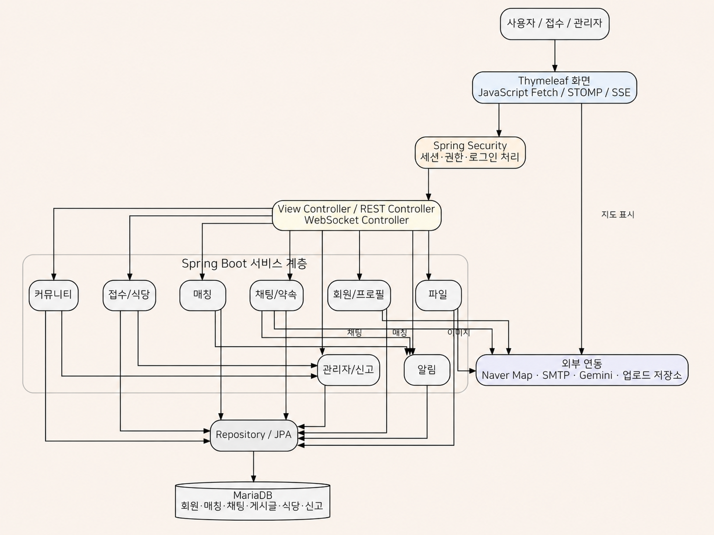

# 학식목장 — 대학생 위치 기반 식사 매칭 서비스

> 혼밥이 흔해진 대학생들이 근처에서 함께 밥 먹을 사람을 찾고,
> **매칭 → 채팅 → 약속 → 식당 예약 → 리뷰**까지 한 흐름으로 이어 가는 캠퍼스 서비스

| | |
|---|---|
| 기간 | 2026.05.07 ~ 06.28 (국비 교육 팀 프로젝트) · 이후 개인 개선 |
| 인원 | 4명 — 유준영(팀장), 최진우, 전정수, 원태규 |
| 배포 | AWS EC2 + RDS |
| 원본 저장소 | [project-mokjang/haksik](https://github.com/project-mokjang/haksik) — 이 저장소는 원본을 포크해 개인 개선 작업을 이어 간 저장소입니다 |

## 목차
1. [기획 배경](#기획-배경)
2. [화면](#화면)
3. [주요 기능](#주요-기능)
4. [아키텍처](#아키텍처)
5. [기술 스택](#기술-스택)
6. [팀 구성과 역할](#팀-구성과-역할)
7. [내가 맡은 기능](#내가-맡은-기능)
8. [주요 개선: 단체 매칭 동시 요청 문제](#주요-개선-단체-매칭-동시-요청-문제)
9. [테스트](#테스트)
10. [한계와 다음 단계](#한계와-다음-단계)
11. [실행 방법](#실행-방법)
12. [패키지 구조](#패키지-구조)

---

## 기획 배경
혼자 하는 문화가 늘면서 대학생들도 혼자 밥을 먹는 일이 많아졌습니다.
같은 학교 학생끼리 가까운 곳에서 함께 밥을 먹으며 어울릴 수 있도록 **위치 기반 식사 매칭**에서 시작해, 채팅·약속 조율·식당 예약·커뮤니티로 범위를 넓혔습니다.
학교 웹메일 인증으로 가입한 학생만 이용하는 폐쇄형 서비스입니다.

## 화면
> 기획 단계 와이어프레임입니다.

| 상대 찾기 지도 | 채팅방 | 약속 잡기 | 식당 상세 |
|:---:|:---:|:---:|:---:|
|  |  |  |  |

## 주요 기능

**사용자**
- **위치 기반 매칭** — 지도에서 내 위치 기준 반경 안의 상대를 찾고, 식사(1:1·단체)·소개팅·과팅 목적별로 매칭
- **채팅·약속** — 매칭이 성사되면 채팅방 자동 생성, 채팅방 안에서 시간·장소 확정 폼과 투표
- **식당 예약·리뷰** — 학교 주변 식당 예약 신청, 방문 후 리뷰
- **신뢰 시스템** — 상호 평가 기반 매너 점수, 노쇼 누적 시 이용 제한, 활동 배지
- **커뮤니티** — 학교 전용 게시판과 전체 대학생 게시판, 댓글·이미지 첨부
- **회원** — 학교 웹메일 인증 가입, 로그인 5회 실패 시 30분 잠금

**점주** — 가게·메뉴 등록, 영업 상태·품절 관리, 예약 수락·거절, 리뷰 관리

**관리자** — 회원 관리, 점주 가입 승인·반려, 채팅·게시글·리뷰 신고 처리

**이후 추가** — AI 신고 판정·식당 추천 (Claude API)

## 아키텍처



- 화면은 Thymeleaf로 서버에서 렌더링하고, 채팅은 WebSocket(STOMP), 알림은 SSE로 실시간 전달합니다.
- Spring Security가 세션·권한(사용자/점주/관리자)을 처리합니다.
- 프로젝트 종료 시점 설계서라 외부 연동에 Gemini가 표시돼 있습니다. 이후 AI는 Claude API로 전환했습니다.

## 기술 스택

| 구분 | 기술 |
|---|---|
| Backend | Java 21, Spring Boot 3.5, Spring Security, Spring Data JPA, QueryDSL |
| 실시간 | WebSocket(STOMP, 채팅), SSE(알림) |
| Database | MariaDB |
| Frontend | Thymeleaf, HTML, CSS, JavaScript |
| 외부 API | Naver Maps API, Google SMTP(메일 인증), Claude API |
| Infra | AWS EC2, RDS |
| Tools | Git, GitHub, IntelliJ, Gradle |

## 팀 구성과 역할

| 이름 | 담당 |
|---|---|
| **유준영 (팀장)** | 로그인(Spring Security), 네이버 지도 연결, 위치 기반 매칭, 관리자 페이지(회원·점주·신고), 신뢰 시스템(매너 점수 차감·잠금), 공통 UI와 전체 프레임 설계 |
| 최진우 | 커뮤니티(게시글·댓글), 점주 페이지(가게·메뉴·예약), 식당 리뷰, 알림, 이메일 인증, 약관 동의 |
| 전정수 | 실시간 채팅, 지도 기반 장소 약속 폼, 사용자 리뷰, 배지, 사용자 회원가입, 상대 평가(신뢰 시스템) |
| 원태규 | 프론트 디자인, 아이디·비밀번호 찾기, 점주 회원가입, 마이페이지, AI 챗봇, 학교 목록 저장 |

## 내가 맡은 기능

### 위치 기반 매칭
```
대기 등록 ─▶ 매칭 신청 ─▶ 수락 / 거절 / 취소 ─▶ 성사 시 채팅방 생성
    └──────────── 시간이 지나면 대기 자동 만료 (1분 주기 스케줄러) ──┘
```
- 목적별 매칭: 식사 1:1, 학식 단체, 소개팅, 과팅
- 흐름이 어긋나는 상황을 서버에서 검사해 이유와 함께 막음
  - 자기 자신에게 신청 / 같은 모집방 중복 신청 / 같은 사용자끼리 진행 중인 요청 중복
  - 단체방 정원 초과 / 모집자의 다른 매칭 신청 / 이미 처리된 요청 / 확정된 매칭이 있는데 새 대기 시작

### 관리자
회원 목록·상세, 점주 가입 승인·반려, 신고 처리 화면과 API

### 로그인·신뢰 시스템
Spring Security 로그인, 로그인 실패 5회 시 30분 계정 잠금, 매너 점수 차감

### 팀장으로서
공통 UI와 전체 프레임 설계, Git 브랜치 관리(엉킨 브랜치 이력 복구), 계층별 패키지를 **기능별 패키지**로 재구성

### 프로젝트 이후
AI 신고 판정·식당 추천 기능 추가와 Claude API 전환, 매칭 동시성 개선(아래)

---

## 주요 개선: 단체 매칭 동시 요청 문제

> 상세 기록: **[docs/matching-concurrency.md](docs/matching-concurrency.md)** · 브랜치 [`fix/matching-concurrency`](https://github.com/yjuny03/haksik/tree/fix/matching-concurrency)

**문제** — 단체 학식 모집방은 정원을 확인한 뒤 인원을 늘리는 구조였지만, 두 과정 사이에 잠금이 없었습니다. 같은 모집방에 요청이 동시에 들어오면 서로의 변경을 보지 못했습니다.

**재현** — 동시 요청 테스트로 직접 확인했습니다 (남은 자리 2개, 동시 10건 × 20라운드).

| 시나리오 | 수정 전 | 수정 후 |
|---|---|---|
| 동시 수락 (MariaDB 12 기본) | 10건 중 9건 DB 오류, 1명만 수락 | **정확히 2명 수락, 채팅방 1개**, 나머지는 정원 마감 안내 |
| 동시 수락 (MySQL·이전 MariaDB 동작) | 자리 2개에 10명 수락, 채팅방 10개 | 위와 같음 |
| 같은 사람의 동시 중복 신청 | 10번 신청에 9~10건 저장 | **1건만 저장** |

**해결** — 모집방 행을 `SELECT ... FOR UPDATE`로 잠그는 **비관적 락**. 같은 방에 요청이 몰리는 구조라 재시도가 필요한 낙관적 락보다 줄 세워 처리하는 쪽을 골랐습니다.
잠금은 메서드 **맨 처음**에 걸고 READ COMMITTED로 읽습니다. 잠금 전에 엔티티를 읽어 두면 영속성 컨텍스트와 REPEATABLE READ 스냅샷 때문에 앞 요청의 결과가 보이지 않기 때문입니다.

## 테스트

전체 **108개 테스트 통과** (로컬 MariaDB 12.3, 2026.11 기준)

| 영역 | 테스트 수 | 내용 | 작성 |
|---|---:|---|---|
| 매칭 동시성 | 8 | 동시 수락·중복 신청 재현, 잠금 메서드 단일 요청 동작 | 유준영 (이후 개선) |
| AI 신고 판정·신고 처리 | 64 | 자동 숨김 정책, Claude 응답 처리, 중복 신고·제재·복구, 관련 항목 일괄 처리, 관리자 알림·대시보드 | 유준영 (이후 개선) |
| AI 식당 추천 | 10 | 후보 조회·반경 확대, 점수 계산, AI 실패 시 DB 점수 기반 대체, 챗봇 연동 | 유준영 (이후 개선) |
| 점주 서비스 | 7 | 가게·예약·리뷰 서비스 | 최진우 |
| 회원가입·애플리케이션 | 2 | 회원가입 통합 테스트, 컨텍스트 로드 | 유준영 |
| 시연 데이터 생성 | 17 | 발표 시연용 더미 데이터 (매칭·채팅·커뮤니티·점주·관리자 등) | 팀 전체 |

> 프로젝트 기간에는 시연 데이터를 만드는 테스트가 대부분이었고, 동작을 검증하는 테스트는 이후 개선 작업에서 직접 채웠습니다.

```bash
./gradlew test                                                              # 전체
./gradlew test --tests 'com.example.haksikmokjang.matching.concurrency.*'   # 매칭 동시성만
```
- 전체 테스트는 `application.properties`의 개발 DB에 시연 데이터를 기록합니다.
- 매칭 동시성 테스트는 별도 스키마 `haksik_concurrency_test`를 자동으로 만들어 씁니다.

## 한계와 다음 단계
- **배포 환경 미확인** — 동시성 문제는 로컬 MariaDB 12.3에서 재현했습니다. 운영했던 AWS RDS의 버전은 확인하지 못해, 실제 서비스에서 어떤 증상이 났을지는 단정하지 않습니다.
- **모집방 단위 잠금** — 한 방에 요청이 몰리면 그 방의 요청은 순서대로 처리됩니다. 다른 방에는 영향이 없습니다.
- **테스트 격리** — 기존 테스트 일부가 개발 DB에 데이터를 커밋합니다. 테스트 전용 DB 설정으로 분리하는 것이 다음 과제입니다.
- **화면** — 위 화면은 기획 단계 와이어프레임이며, 실제 구현 화면은 다를 수 있습니다.

## 실행 방법

**필요 환경**: Java 21, MariaDB

1. MariaDB에 `project_mokjang` 데이터베이스를 만들고, `application.properties`의 datasource 계정을 본인 환경에 맞게 수정합니다.
2. `src/main/resources/application-local.properties`를 만들고 아래 값을 채웁니다. (Git에 올라가지 않는 파일)
   ```properties
   naver.map.client-id=네이버_지도_클라이언트_ID
   spring.mail.username=메일_계정
   spring.mail.password=메일_앱_비밀번호
   ai.provider=mock
   ```
   `ai.provider=mock`이면 실제 AI 대신 고정 응답을 사용합니다.
3. 실행
   ```bash
   ./gradlew bootRun
   ```

## 패키지 구조
기능별로 패키지를 나누고, 그 안에 controller · service · repository · domain · dto를 두었습니다.
(처음에는 계층별로 나눈 뒤 그 안을 기능별로 나눴는데, 기능 하나를 고칠 때 여러 폴더를 오가야 해서 바꿨습니다.)

```
com.example.haksikmokjang
├── matching        # 위치 기반 매칭 (matchingwaiting, matchingrequest)
├── member          # 회원·가입·약관·배지·신뢰 시스템
├── admin           # 관리자 (회원, 신고, 대시보드)
├── chat            # 채팅방·메시지·약속 폼
├── community       # 게시글·댓글
├── ownerpage       # 점주 가게·메뉴·예약
├── notification    # 알림 (SSE)
├── report          # 신고
├── ai              # AI 신고 판정·식당 추천
├── chatbot, school, fileattachment, view
└── global          # 공통 응답·예외·보안 설정
```
